<!-- profile-light.svg and profile-dark.svg are generated by generate_profile.py
     and refreshed daily by .github/workflows/refresh-profile.yml. -->
<picture>
  <source media="(prefers-color-scheme: dark)" srcset="./profile-dark.svg">
  <source media="(prefers-color-scheme: light)" srcset="./profile-light.svg">
  
</picture>
